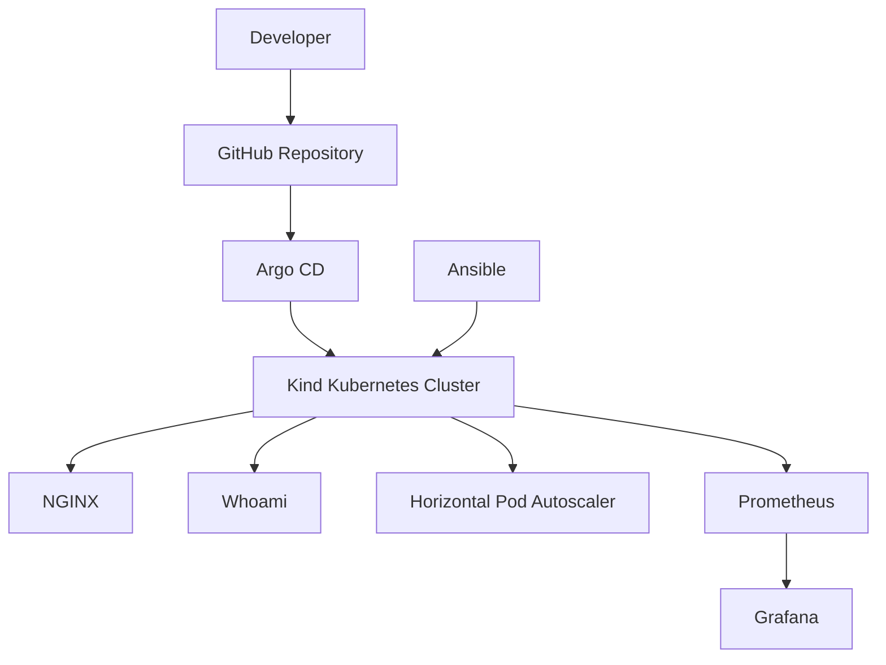

# Kubernetes GitOps Platform

A local Kubernetes GitOps platform built with Kind, Helm, Argo CD, Ansible, Prometheus, and Grafana. It demonstrates Git-based deployments, autoscaling, health checks, and monitoring.

## Architecture



## Technology Stack

| Technology | Purpose |
|---|---|
| Kind / Kubernetes | Local cluster |
| Docker | Containers |
| Helm | Application packaging |
| Argo CD | GitOps delivery |
| Ansible | Health-check automation |
| Prometheus | Metrics collection |
| Grafana | Dashboards |
| GitHub | Source control |

## Project Structure

```text
ansible/       Inventory and health-check playbooks
argocd/        Argo CD application configuration
helm/nginx/    NGINX Helm chart
helm/whoami/   Whoami Helm chart
kubernetes/    Kubernetes application manifests
monitoring/    Prometheus stack values
README.md      Project documentation
```

## Implemented Features

- Created a local Kubernetes cluster using Kind.
- Deployed NGINX and Whoami using Helm.
- Connected GitHub to Argo CD for GitOps synchronization.
- Configured Whoami HPA with 2–5 replicas and a 70% CPU target.
- Tested autoscaling under simulated load.
- Automated cluster, namespace, application, pod, and HPA checks with Ansible.
- Installed Prometheus and Grafana using kube-prometheus-stack.
- Verified metrics and Kubernetes resource dashboards.

## Run Ansible Health Checks

```bash
ansible-playbook -i ansible/inventory/hosts.ini ansible/site.yml
```

## Validation Results

| Component | Result |
|---|---|
| Kubernetes node | Ready |
| NGINX Argo CD application | Synced / Healthy |
| Whoami Argo CD application | Synced / Healthy |
| Whoami pods | 2 Running |
| HPA | 2–5 replicas, 70% CPU target |
| Prometheus | Metrics available |
| Grafana | Dashboards displaying data |
| Ansible | 0 failed tasks |

## Access the Dashboards

Run each port-forward command in a separate terminal.

**Argo CD**
```bash
kubectl port-forward svc/argocd-server -n argocd 8080:443
```
Open https://localhost:8080

**Grafana**
```bash
kubectl port-forward svc/monitoring-grafana -n monitoring 3000:80
```
Open http://localhost:3000

**Prometheus**
```bash
kubectl port-forward svc/monitoring-kube-prometheus-prometheus -n monitoring 9090:9090
```
Open http://localhost:9090

## Key Learnings

- Kubernetes administration and troubleshooting
- Helm chart deployment
- GitOps with Argo CD
- Horizontal Pod Autoscaling
- Prometheus and Grafana monitoring
- Ansible automation
- Git and GitHub workflows

## Author

**Pranav Changan**

GitHub: [pranavchangan2005-cyber](https://github.com/pranavchangan2005-cyber)

Repository: [k8s-gitops-platform](https://github.com/pranavchangan2005-cyber/k8s-gitops-platform)
